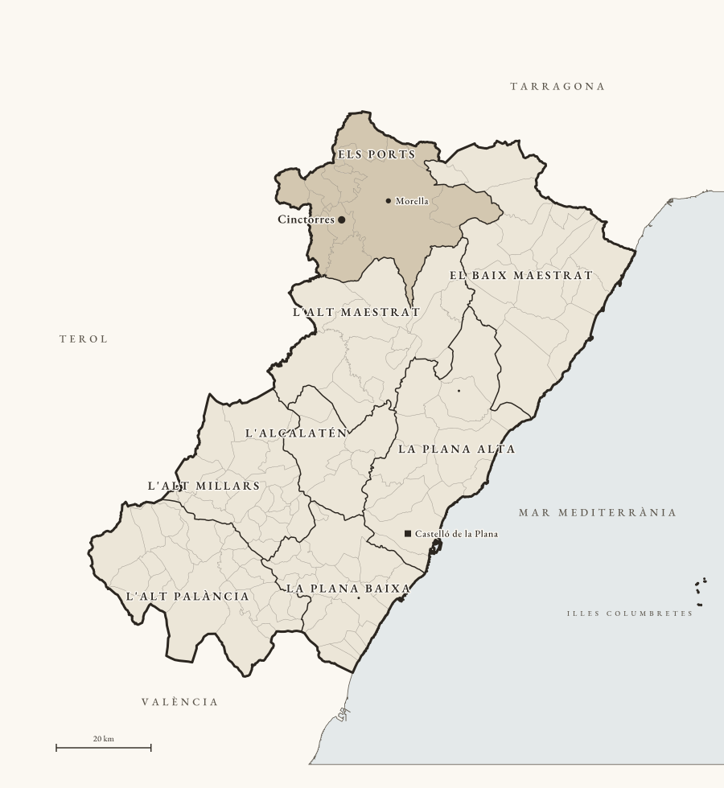
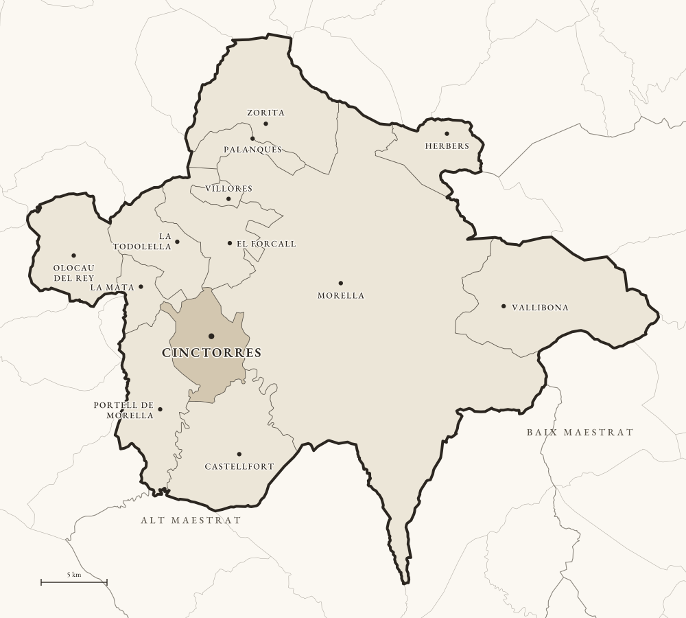

# 1. SITUACIÓ

Cinctorres està situat a l’extrem nord de la província de Castelló, és a dir, a l’interior i al nord de la província. El nucli urbà està a 906 metres d’altitud respecte al nivell de la mar i ubicat a les següents coordenades geogràfiques: 40º 35’de latitud nord, 0º 13’ de longitud oest, formant part de la comarca dels Ports.

Tot el que jo diga de la història del poble i dels seus habitants, ja està dit amb molta més autoritat i coneixement. Sols cal mirar i llegir els dos volums editats per l’Ajuntament l’any 1999 amb els títols *Cinctorres, volum I* i *Cinctorres, volum II, Els nous temps*, en els quals apareix tota la història del poble i dels seus habitants.

El meu interès, està més centrat amb el paviment del saló principal de la casa palau de Santjoans, no de bades, en la meua infantesa vivíem just a la casa d’enfront i degut als comentaris que feia mon pare dient: «*a la casa de don Vincent (el metge del poble, que vivia en la casa Santjoans) hi ha un saló amb rajoles d’animals que tu no has vist mai*». Fins molts anys després no ho vaig veure, i això va ser visitant l’exposició dels quadres premiats al concurs de pintura, en les festes del poble.
