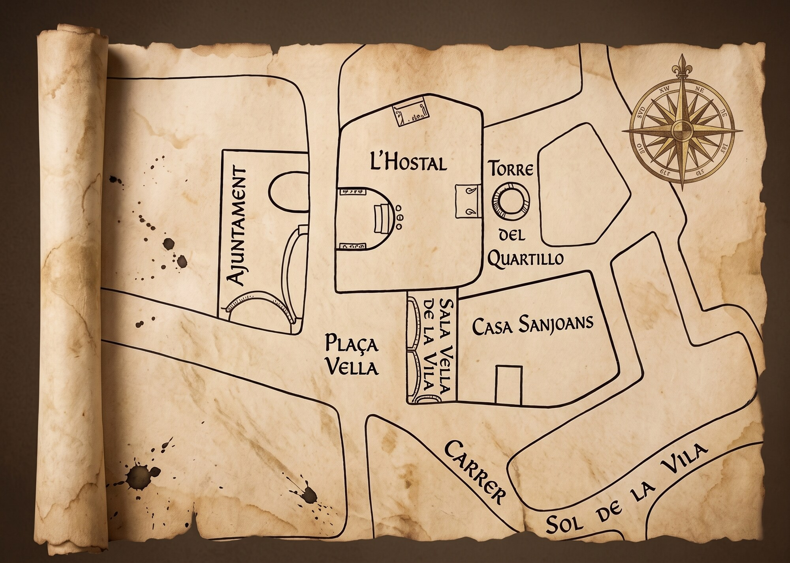
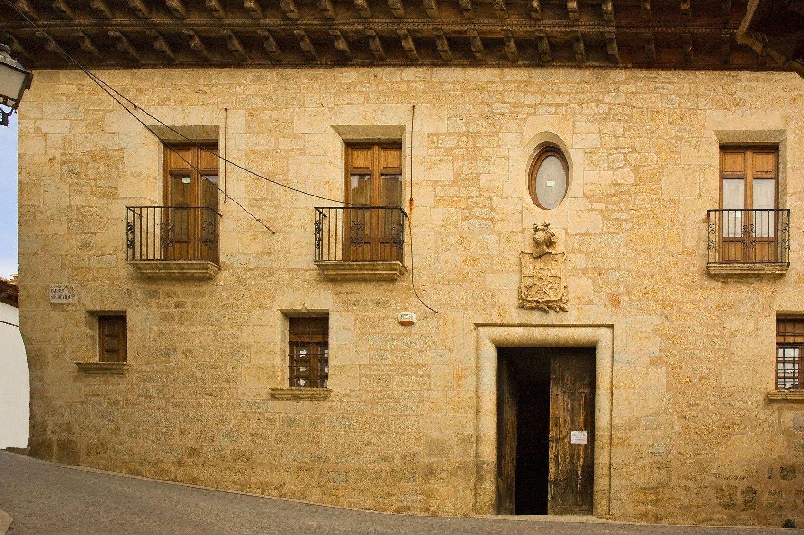
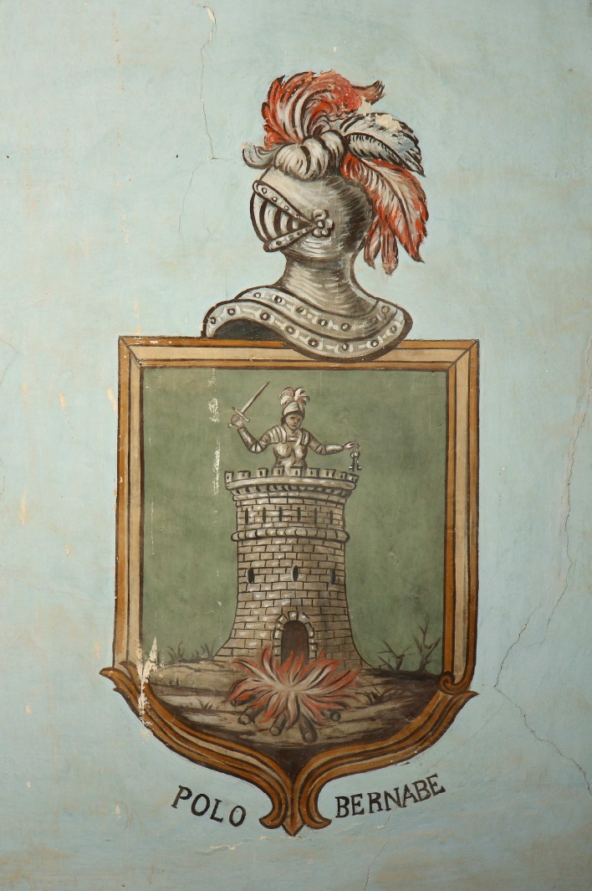
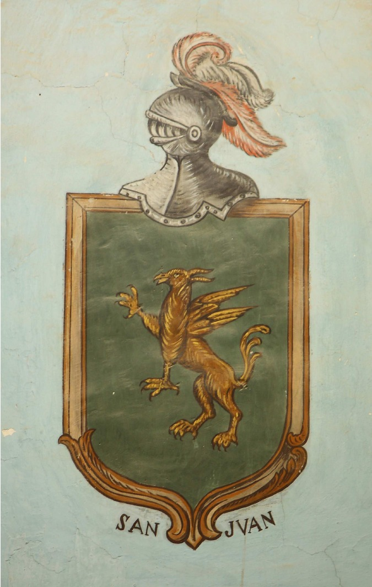
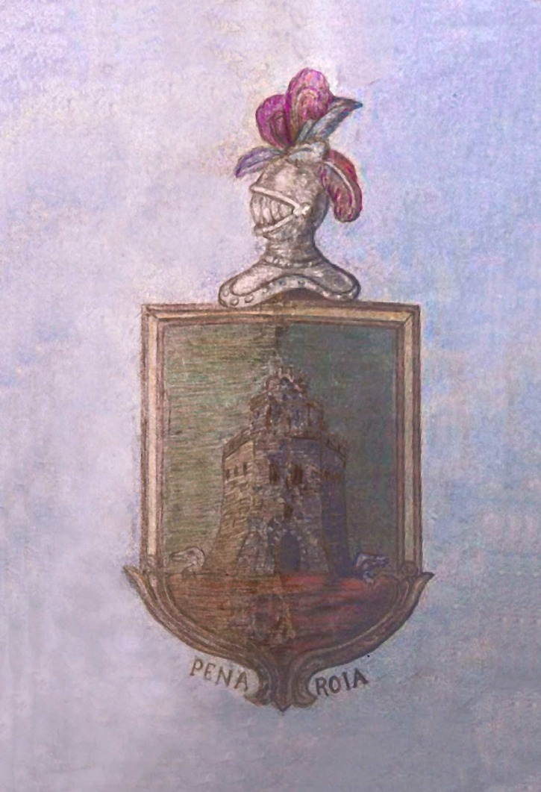
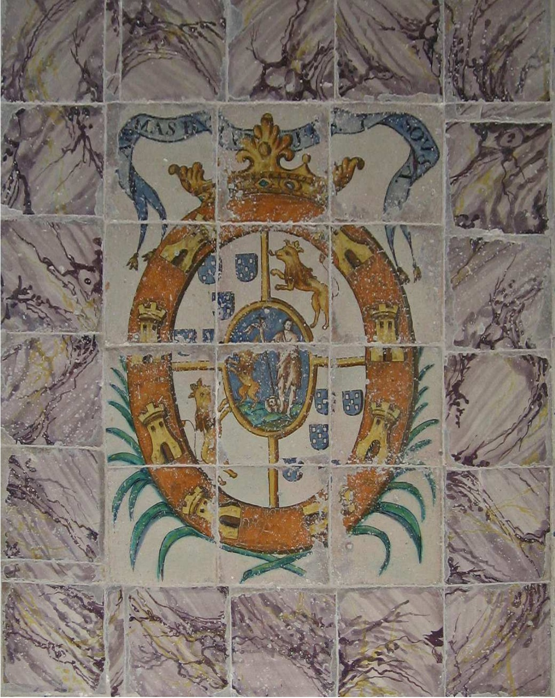

# 2. NAIXEMENT DE LA CASA SANTJOANS

De totes les places que hi ha al poble de Cinctorres, la plaça Vella és la més menuda, però la més important de totes, on estan situats els edificis civils més representatius de la Vila com l’Ajuntament, d’estil aragonès (segons el professor de la Universitat de Castelló Víctor Mínguez, el més pur de la comarca), també l’edifici que ja en documents històrics s’anomena com l’hostal i la casa palau de Santjoans, que fa cantonera amb dita plaça i el carrer Sol de la Vila, o de la Solana. Aquest carrer està orientat direcció est i sud-est, i sobre ell es va formar el poble[^1].

La façana de la casa Santjoans és austera, de pedra picada, amb rafels dobles de fusta, d’estil aragonès i planta quadrada.
Damunt de la porta principal hi ha un gran escut de pedra, on s’aprecien les armes de diferents famílies nobles lligades a la història de Cinctorres.

També, al voltant de la majestuosa escala de l’interior del palau, es veuen actualment, diversos escuts heràldics, policromats, de famílies que allí han viscut, com Polo de Bernabé, Sanjoan, De Pedro i Penarroja. I coronant tota l’escala donant-li llum directa, una torre quadrada amb coberta de quatre aigües, i en el sostre, dominant tot el conjunt, un escut policromat de forma ovoïdal amb una barreja d’armes familiars molt interessant.

El primer habitant: Polo de Bernabé, en la primera meitat del segle XVI fins l’última generació de Sanjoan en 1827.

## 2.1. POLO DE BERNABÉ.

El nom Polo és d’origen francès d’Aquitània, i el Bernabé de la Rioja, on es va engrandir en la defensa del castell de Baquera en el S. XIV. A meitat del S. XV s’uniren, adoptant l’escut d’armes i el nom Polo de Bernabé. Té el solar en Anento, comunitat de Daroca. En aquest lloc està censat Domingo Polo de Bernabé, infantó l’any 1505.

No sabem en quina data ni com va arribar a Cinctorres Jaime Domingo Polo de Bernabé, ni quan s’uní en matrimoni amb Gerònima Montargull, natural de Cinctorres, on viuran ells i els seus descendents, que amb el temps s'escampen per diferents llocs com ara Mosquerola (Terol) i també a Vistabella (Castelló).

El cognom Montargull és important doncs en el Llibre Memorial de 1534. Johan Montargull és Justícia i en el Memorial de 1545 apareix com Jurat.

Arxiu Històric de Cinctorres: *Llibre Memorial de lo loh de Cinctorres del quitament del moble y dels vehins de dot loh que an quitat aquell y dels censats que dita Universitat te segons en ell poren clarament veure 1534.*[^2]

El consell està compost per Johan Montargull com a menor justicia, Berthomeu Costa com a jurat i Johan Valles també com a jurat. En total 33 veïns.

En aquest mateix document es veu per primera vegada el cognom Polo. En el lloc nº 27 trobem Antoni Polo.

En el Llibre Capatró de les peytes[^3] de 1581 també Antoni Polo Cabrera.[^4]

En les peytes de 1598 els germans, Joan, Miguel, i Jaume Polo Cabrera.[^5]

També en el Llibre Memorial de l’any 1534 Jaume Polo menor, està inscrit com clavari, encarregat dels comptes i de cobrar a diferents veïns la quantitat de lliures citades, en concepte d’impostos, amb data 1627.

Antoni Polo de Jaume peyta en 1640.

També la viuda d’Antoni Polo en data 1640.

L’any 1672 peyta Jaume Polo d’Antoni.

No tinc la seguretat que tots els Polo estan emparentats, però són un testimoni en els documents citats.

## 2.2. SANTJOAN

En el següent document històric es veu el cognom Santjoan.

La torre del Quartillo que compra el primer Sanjoan, es creu que era un dels llocs més importants, i una torre de defensa d’origen àrab. No sabem quin tipus de penúria hi havia per a vendre’l, com així consta en aquest document.

Arxiu Històric de Cinctorres. Llibre de Consells 1677-1712

*Torre del Quartillo. Així fonda proposat per li S.Jurat en Cap que Marco Sanjoan donara quinze lliures de la Torre del Quartillo. Y que atesa la penúria li vendria ab dit preu. Y que dit senyors fah resolt que li ven de dite cantitat .*

El quartillo. Lo cortillo. És un dels topònims de significat més fosc. Entre altres Cort és sinònim de Casa de la Vila. El Cortillo està situat a la vora del centre administratiu de la vila.

## 2.3. JAUME SANJOAN Y POLO

Aquest següent escrit ens demostra que els noms Polo i Sanjoan ja estan units, però l’actual casa palau encara no existeix. Les que hereta i declara són més menudes i estan situades al carrer Sol de la Vila, al costat de la Sala Vella de la Vila, un espai que es creu amb porxets i bancs de pedra que enfronta amb l’Ajuntament. En aquest lloc després es construirà la nova casa Sanjoan y desapareix la Sala Vella de la Vila.

Aquest document també és un testimoni de tres generacions de cinctorrans.

*Llibre Capatro de les peytes 1745*

*Unes casses ahon de present habite en lo carrer que baixe de la plasa al Soldevila que en peytes pasades peytave Jaume Polo de Antoni ahon diu que en peytes de Raimundo Grau estaven en tres ittims contiguos..les quals compra lo dit Polo de Jusep Bovil y el peytant les posehix per herencia,y al present afronten ab la sala Vella de la Vila ab dit carrer ab lo carrero que va al forn ab lo dit carrero que va de la plasa al forn ab lo dit forn, ab pati del Cortillo y ab ort y cassa del hostal, y fa de peyta 1345 lliures”6 sous .*

*Ittem. La Torre del Cortillo que en peytes pasades pertany a Dº- Francisco de la Gana la cual li ven la Villa a Marco Sanjuan sonpare y enfronten amb lo Cubert del Forn la cassa mateix y amb lo Cortillo y part del portal y fa de peytes 400 lliures .Peyta nº 103.*[^6]

## 2.4. FRANCISCO JAVIER SANJOAN I PENARROJA

L’escut Penarroja és de Joan Bautista Penarroja, notari de Vilafranca, nombrat cavaller amb dret de vot en les Corts Valencianes, que l’atorga el rei Carlos II el 16 de juliol de 1691.

Ell va ser anomenat per part de les aldees, com Síndic Procurador per aconseguir la separació de Morella.

En la carta pobla de Morella en 1233 es coneix per primera vegada l’existència de les aldees, però es possible que esta estructura ja existirà en temps musulmans.

Després de diversos intents, en 1690 es torna a demanar amb plet la separació. Les aldees son: Castellfort, Catí, Cinctorres, El Forcall, La Mata, Olocau, Portell, Vallibona i Vilafranca.

Entre totes recullen “*20000 reales de a ocho de plata doble castellana de moneda antigua*” que entreguen a la corona i en data 9 de febrer de 1691 es signa la independència i passen a ser viles reials.[^7]

El síndic Penarroja tenia propietats en poble i terme de Cinctorres i una filla seua es casa amb un Polo.

Francisco Javier Sanjoan i Penarroja. que ha nascut i viu a Cinctorres, es casa amb Dª Ysabel Sousa natural de València.

També esta documentat que el 27 de març de 1763, sent alcalde de Cinctorres D. Javier Sanjoan i Penarroja, es va fer el compromís de construir l’actual temple parroquial. Aquest es va beneir el 28 de setembre de 1782 i en 1770 es signa la relació de les confraries existents al poble.

## 2.5. JOAQUIN SANJOAN I SOUSA.

Fill únic del matrimoni Sanjoan i Sousa, Don Joaquin Sanjoan i Sousa es casa amb Dª Maria Joaquina Piquer Zaldua, natural de Morella.

Don Joaquin era Caballero Maestre de lo Real de Ronda i administrador depositari dels comptes de Sant Vito de la parròquia de Cinctorres.

Del matrimoni entre Don Joaquin i Dª Joaquina va nàixer el que es creu únic fill, Francisco Javier Miguel Jaume, el 4 de juny de 1803. Aquest va morir sent infant.

L’escut heràldic amb les armes de Sanjoan y Sousa, cognom d’origen portuguès, presideix el saló noble de la casa dels Sanjoan: La figura de San Joan, i els cinc escuts en blau, amb cadascun cinc vessants d’argent ficats en gaiat i també les torres del voltant, es propi del cognom Sousa, portuguès, semblant a l’escut de Portugal, amb la variant d’escuts i vessants amb forma de creu. La llegenda escrita diu, ARMAS DE SANJOAN I SOUSA.

El solat de paviment ceràmic està format per: al centre l’escut heràldic i al voltant figures zoomòrfiques i de flors, fabricades en la segona meitat del S.XVIII

Dit saló es creu que està situat damunt d’on en 1745 era la Sala Vella de la Vila, un espai obert del poble. Actualment és tot un edifici.

A l’entrada de l’actual palau s’aprecien les arcades i els bancs de pedra al voltant, que molt bé poden ser els mateixos que hi havia en la sala vella de la vila. La paret que dóna a la plaça Vella és de maçoneria, diferent a la resta de l’edifici que és de pedra picada. Si et fixes bé, en la façana de pedra i els ràfels de fusta es veu la diferència i s’aprecia l’ampliació del Palau.

## 2.6. LLIBRE PADRÓ DE CINCTORES 1817

*En la casa Sanjuan viven y estan censados Don Juaquin Sanjuan y Sousa , la seua muller Dª maria Juaquina Piquer y Don Juaquin Sanjuan y Peñarroja (tio carnal de Sanjuan i Sousa) y tambien 4 criados.*

Actualment en la capella panteó del cementeri de Cinctorres estan soterrats:

- Dª Ysabel Sousa de Sanpayo en 19 de març 1817.
- D. Joaquín Sanjoan i Sousa en 3 d’octubre 1825.
- D. Joaquín Sanjoan i Penyarroja en 22 d’abril 1826.
- Dª Joaquina Piquer de Sanjoan 14 de desembre 1827.

En el testament del matrimoni es desprèn que ací s’acaba la família directa dels Sanjoan a Cinctorres.

Els seus parents de segon o tercer grau rebien quantiosos béns si complien amb l’obligació d’unir-se en matrimoni amb familiars detallats en el seu testament, amb l’obligació de viure en dita vila

Aquestes condicions no es van complir per part dels hereus, aleshores demanen dispensa al rei Ferran VII e inicien litigi.

La casa Santjoans va passar a ser de propietat privada. Actualment pertany a la Diputació de Castelló, que ha cedit el seu ús a l’Ajuntament de Cinctorres.

[^1]: Volum nº 1 Cinctorres. Toponimia medieval, Ferran Guardiola. Pag. 199.
[^2]: Llibre Memorial. Arxiu Històric de Cinctorres. Característiques. Data 1534. Original. Llibre. 75 fulls. Paper 290x240 mm. Cobertes de pergamí. En aquest llibre estan documentats els trenta membres del consell, els dos jurats i un justícia.
[^3]: Arxiu Històric de Cinctorres. Capatró de peytes. Llibre de comptes any 1745, on están detallats els comptes i la quantitat que es paga. Paregut a l’actual contribució i un lloc on están detallats càrrecs i finques dels veïns.
[^4]: Volum nº 1. Cinctorres. Toponímia. Ferran Guardiola. Pag. 220.
[^5]: Arxiu Històric de Cinctorres. Llibre de peytes 1581. Llibre de comptes.
[^6]: Arxiu històric de Cinctorres. Judiciari. Data 1526. Llibre de comptes on está escrit tot el que te relació amb el Consell de Cinctorres i dels seus veïns.
[^7]: *La independéncia de las aldeas de Morella*. José Eixarch Pag. Nº 161. El sistema monetari estava indicat amb lliura, sous i diners. La lliura castellana son 27 sous i quatre diners. El ducat son 21 sous. El reial valencià es un sou i mig. El reial castellà es un sou amb 8 diners. El florí d’or son 11 sous però 13 o més a finals del segle. El dobló son 19 sous i 4 diners.
