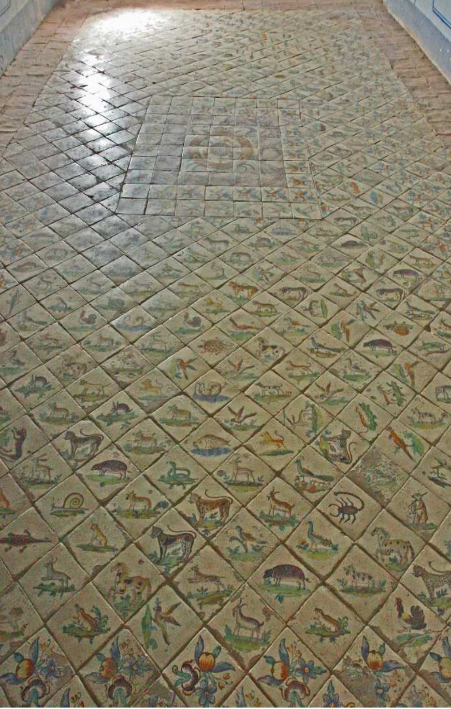
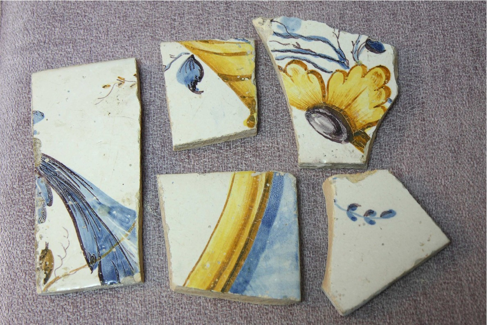
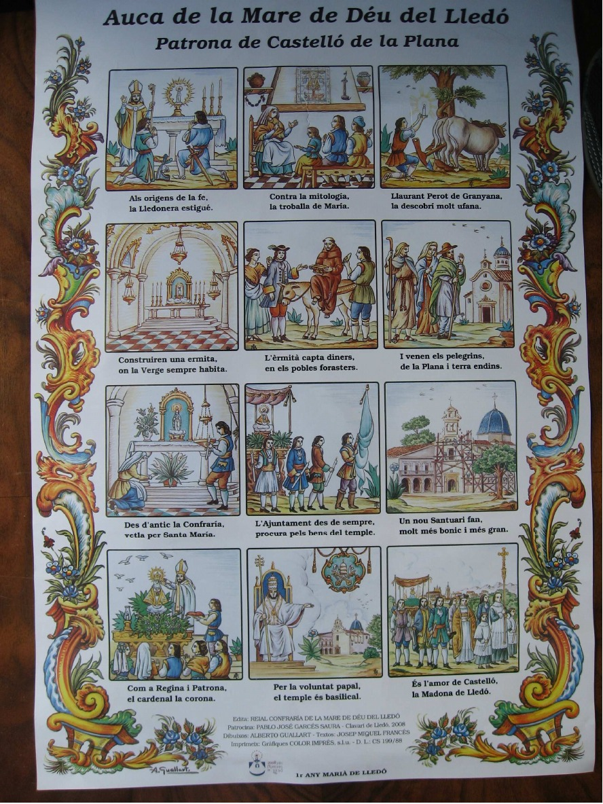
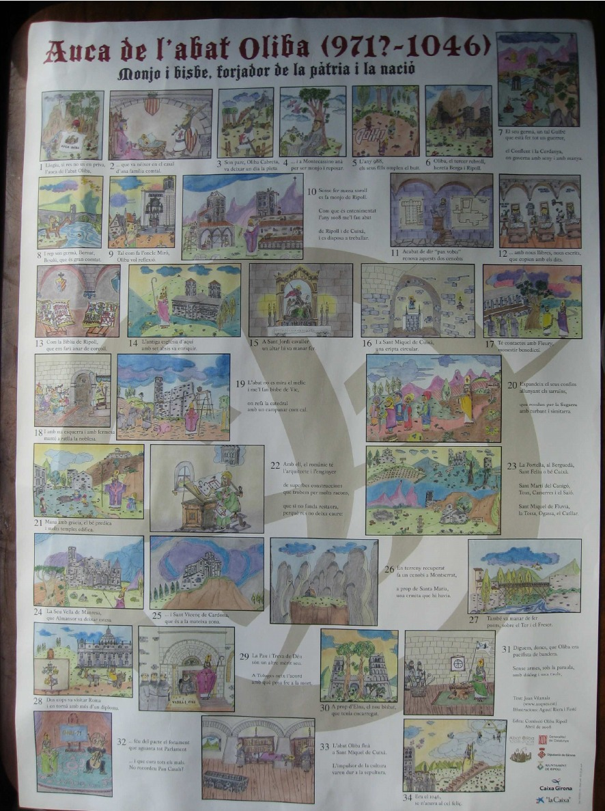

# 3. PAVIMENT

## 3.1. CARACTERÍSTIQUES

El paviment ceràmic del saló principal del palau de Santjoans està situat en el primer pis, en la planta noble, dóna a dos carrers, a la plaça Vella i al carrer Sol de la Vila. El solat esta compost per diferents rajoles majòliques, policromades amb diversos motius d’animals, de flors i també imitant mabre amb jaspis de manganesos.

Les rajoles són de sèrie, vol dir, que als comerços hi havien més. No així les rajoles que formen l’escut, aquestes són d’encàrrec.

Format: cada rajola mesura 20,50x20,50 cm. Tot el conjunt 380x830 cm. ocupant la quasi totalitat de la sala.

La quantitat exacta de rajoles policromades amb motius és:

- 331 d’animals diversos.
- 392 de flors, de tres models diferents
- 34 imitant marbre.

Tot el conjunts fins arribar a la paret l’envolta dos rengleres de paviment de fang cuit. Aquest paviment encara es pot veure per totes les cases del poble.

## 3.2. L’ ESCUT HERÀLDIC

L’escut policromat, és un rectangle de 3x4 peces. Al seu voltant, com una orla, 18 rajoles imitant marbre de color agrisat amb manganesos i també 24 rajoles de flors, totes iguals, que emmarquen el conjunt. Aquest mesura 140 cm d’ample per 200 cm de llargària.

Al centre del saló està col·locat l’escut de forma rectangular com un retaule, de manera lineal, i la resta del paviment té l’eix diagonal com referència organitzativa.

Les rajoles amb bandes i jaspis de manganesos púrpura, imitant marbre, són idèntiques al retaule de la Trinitat del Museu Nacional de València de l’any 1787, data que es veu en la cartela inferior de dit retaule. També, la Verge dels Desemparats d’Albaida o la de Aielo de Malferit tenen bandes de manganesos idèntiques i la data inscrita és 1788 i 1790. Per aquest motiu es creu que la data de fabricació es la mateixa o almenys molt propera.

## 3.3. FABRICACIÓ

Veient les dates anteriors es pot dir que el paviment de Cinctorres es fabrica l’últim quart del S. XVIII en las *Reales Fábricas de València,* als carrers *Mossèn Femares i de las Barcas,* el propietari de les quals es diu Marcos Aurelio Disdei. Quan aquest mor es fa càrrec de la direcció de la fàbrica Vicente Miralles, primer oficial.

En una nota d’arxiu de la Cofradia de Sant Vito del 20 de desembre de 1815, es veu detallat la quantitat i el preu del paviment, comprat en 1799 en la fàbrica del carrer *de las Barcas,* que es ficarà a la capella de Sant Vito en l’església de Cinctorres. Aleshores el director de dita fàbrica es Vicente Miralles entre 1799 i 1802.

Actualment sols he pogut trobar cinc petits fragments d’aquestes rajoles que hi havien a la capella de Sant Vito en l’església de Cinctorres. No es pot apreciar el dibuix complet doncs es veu que formaven part del ramejat que envoltava el conjunt, però si algun dels colors utilitzats en la seua fabricació i la mesura que es de 20 x 20 x 1,50 cm.

Bona part de les rajoles del paviment de la casa Santjoans tenen les mateixes característiques: són de fauna variada, reprodueixen la figura d’un sol animal situat damunt d’una illeta amb la funció de pedestal de la figura, en l’hàbitat de l’espècie representada. El resultat és fauna de cada mig: terrestre, aquàtic i les aus.

## 3.4. AUQUES.

L’auca és una iconografia que pareix tindre l’origen en un joc del S. XVII on hi ha 48 figures encasellades en pergamí. Estan representades el sol, la lluna, les estrelles i els signes del zodíac. També s’anomenen *Aleluyas* on es troben llegendes i diferents temes que de vegades fan el paper de referència històrica i també religiosos de diferents oficis i d’animals diversos.

En el S. XVII - XIX, les fàbriques Valencianes de rajoles inclouen un ampli repertori de motius zoològics de les auques, tenien caràcter didàctic i acadèmic i van utilitzar-ne els pintors ceràmics amb molta freqüència.

De l’auca sol i lluna, editada en València per Agustin Laborda i Campos l’any 1752, hi han varies rajoles com ara: Pavó reial, etc .

L’auca *Animales Terrestres* de Agustin Laborda, que es va editar a València en 1760, és el repertori bàsic de la majoria de la sèrie d’animals. Totes i cadascuna de les figures que hi ha en les 48 vinyetes de dita auca, estan representades en el paviment. El pintor en aquest cas ha millorat el tresat tosc i s’aprecia una gran seguritat amb els diferent dibuixos.

També es va editar en València l’auca *Animales Acuáticos*, per la viuda de Agustin Laborda l’any 1780.

I l’Auca *Aves*, editada en València, en 1790 per la Viuda de Agustin Laborda.

De totes estes auques, i en algun cas d’anònimes, son els models de les rajoles que hi ha al saló principal de la casa Santjoans i Sousa de Cinctorres.

## 3.5. MATERIA PRIMA

La base de les rajoles és d’argila molt comprimida, d’aquesta manera es perd la màxima quantitat de partícules d’aire, donant-li la forma al bescuit.

La tècnica que es diu majòlica és mil·lenària i consisteix en esmaltar el bescuit. Per a ficar-lo al forn s’utilitzava un aparell amb forma de trípode o base de tres arestes que impedien que la rajola es pegarà durat la cocció.

El vernís en esta època era estannífer llis, es componia d’una barreja de calcina, arena i sal comú i una quantitat més o menys important de sals sòdiques o potàssiques que cobrien la base fins la primera cocció.

Sobre esta superfície vidriada es decorava amb diversos òxids metàl·lics i es tornava a coure al forn.

Els òxids tradicionals que s’utilitzaven en el segle XVIII eren:

- Òxid de coure.
- Manganesos.
- Cobalt.
- Antimoni.
- Ferro.

Els colors utilitzats en ceràmica en aquesta època són:

- Blau i turquesa amb cobalts.
- Verds càlids i freds amb cobalts i coure.
- Grocs clars i obscurs amb antimoni de plom.
- Taronja clar i ocres amb òxid de ferro.
- Morats i marrons violats amb cobalts i manganesos.
- Negres amb manganesos

Aquest colors s’utilitzaven en totes les manufactures i fàbriques.

Per aconseguir les diferents gammes de colors es feien diferents barreges i pinzellades més o menys aiguades i la temperatura adequada del forn.

## 3.6. RAJOLES VALENCIANES

Com a rajoles Valencianes denominem únicament i exclusiva les fabricades a la ciutat de València.

Segons un dubtós privilegi immemorial, no més les fàbriques de rajoles de la ciutat tenien el permís i el dret a tallar llenya (argelagues, romer i coscolls) dels montes propers, indispensables per al funcionament del seus forns.

*En el Registro de Permisos para la recolección de leña de los montes blancos,* apareixen rebuts de compra que atorgaven també permís de tallar llenya als alfarers, tintorers, vidriers i teulers d’altres pobles del voltant però no a cap fàbrica de rajoles fora de la ciutat de València, monopolitzant així la producció.

Hi ha notícies de documents on es demostren que les rajoles de sèrie des del segle XVII fins meitat del XIX que es produeixen en la ciutat en general, s’agrupaven en tres llocs: al nord prop de la Porta de Quart, a l’oest prop de la Porta de Russafa i en el carrer de las Barcas, tots dins del recinte murallat a excepció d’una en Russafa, i no en altres poblacions, com contínuament i errònia es deia, fins i tot actualment.

En aquesta època en Manises es fabricava vaixella vidriada i en l’Alcora. des de 1727 les vaixelles i ornaments del Comte d’Aranda.

## 3.7. CATÀLEG.

Les següents rajoles catalogades són una petita mostra entre totes les que hi ha al paviment de la casa palau Santjoans de Cinctorres.

Aquestes lletres es corresponen amb la manera de catalogar les rajoles de la Casa de Santjoans:

<dl class="llegenda">
<dt>[D.]</dt><dd>Denominació. Les denominacions són genèriques i eludeixen a l’organització del dibuix i sistemes d’enllaç.</dd>
<dt>[M.]</dt><dd>Mesures. Es donen en cm, indicant les dècimes; a les mesures superficials si és poc es fica també el grossor.</dd>
<dt>[C.]</dt><dd>Color. Es donen els noms convencionals dels pigments i detalls tècnics com el perfilat total o parcial. No es mencionen els fons estannífers perquè són constants en la majoria de les peces catalogades.</dd>
<dt>[F.]</dt><dd>Fabricació. S’indica la localitat i, si es coneix, la fàbrica d’on procedeixen.</dd>
<dt>[Cr.]</dt><dd>Cronologia. Es fa de tres maneres; quan es té referència segura d’any de producció; si es suposa pròxim a una data “c” (aproximadament); si s’atribueix a un període, senyalant les dates extremes que es creuen raonablement límits.[Cr.] 1830 c.</dd>
<dt>[O.]</dt><dd>Ornamentació. És un apartat descriptiu on en ocasions s’inclouen noms convencionals fitomorfs i zoomorfs per raons metòdiques.</dd>
<dt>[L.F.]</dt><dd>Localització i funcions. S’indica ací la població, edifici i funció dels paviments.</dd>
<dt>[Ob]</dt><dd>Observacions. S’assenyala qualsevol aspecte no previst en els apartats anteriors : A més la referència documental quan estiga.</dd>
</dl>
